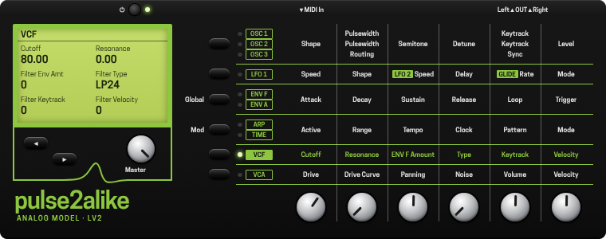

# Pulse2Alike

A reproduction inspired by the Waldorf Pulse 2 as a VST3 and Audio Unit instrument, and as LV2 for MOD devices.

The analogue parts are modelled from captures of a real Pulse 2: the oscillator wave shapes, the
filter (LP24 / LP12 / BP12 / HP12), and the drive and VCA. Captures are taken through the instrument's
external input and MIDI control.

## Working with LLMs

Development started as a solo project. As the project has evolved, I've recently incorporated LLM-assisted development into the workflow, using it as a tool for research, coding, debugging, and experimentation.

## Relationship to the sibling projects

One of a family that shares [SynthLib](https://github.com/chrispurusha/SynthLib) and its format-free
plug-in wrappers:

- **G2Alike**: editor for the Nord G2, and the G2Alike plug-in, including an optional recreation of the sound engine. The capture and analysis tools used here
  live in its `tools/`.
- **SynthEdit**: generic multi-synth editor
- **EmuUtility**: E-mu EOS sampler utility
- **GenBridge**, **MidiSyncTool**, **MidiSeqTool**: plug-ins using the same SynthLib library.

## Installing

From a release's `.dmg`: copy `Pulse2Alike.vst3` into `/Library/Audio/Plug-Ins/VST3` and `Pulse2Alike.component`
into `/Library/Audio/Plug-Ins/Components` (Finder: Go > Go to Folder...). The builds are not notarized, so clear
the quarantine before a host will load them:

    sudo xattr -dr com.apple.quarantine /Library/Audio/Plug-Ins/VST3/Pulse2Alike.vst3
    sudo xattr -dr com.apple.quarantine /Library/Audio/Plug-Ins/Components/Pulse2Alike.component

Then restart the host or rescan its plug-ins; an Audio Unit host may need a log-out and in first. Built from
source, `./do-plugin` installs both for you. The plug-in's Help menu explains the panel, sounds, program
changes and linking a Pulse 2.

## Building

```
./do-plugin            # VST3 and Audio Unit, and installs them
./do-plugin au         # one format
./do-plugin --no-install
tools/do-dcocheck      # offline check of the oscillator law
./do-uncrustify        # after editing sources
```

The VST3 half needs the VST3 SDK at `~/Documents/vst3sdk` (or `$VST3_SDK`); the Audio Unit needs none.

## LV2, for the MOD Dwarf

The same engine as an LV2 plug-in: every parameter of the panel is a control a MOD device can reach, and on its web
interface the plug-in has a panel of its own in the manner of the instrument's - the matrix, the LCD, the six knobs.
Any Linux LV2 host can load it too. Everything is in `lv2/`; the design and the checks are in
`Docs/code-notes/p2Lv2.md`.



**Onto a Dwarf.** With the Dwarf on USB:

```
make -C lv2 publish      # builds build/dwarf/Pulse2Alike.lv2 and installs it on the device at 192.168.51.1
```

That needs Linux with an aarch64 cross compiler and the LV2 headers (`apt install gcc-aarch64-linux-gnu lv2-dev`);
the first build fetches the Dwarf's C library (glibc 2.27, Ubuntu 18.04's) into `build/`, so the plug-in loads on the
device. Without Linux, each push's run of the **LV2** GitHub workflow leaves the same bundle as an artifact:

```
base64 < Pulse2Alike.lv2-moddwarf.tar.gz | curl -F 'package=@-' http://192.168.51.1/sdk/install
```

With MOD's own toolchain instead, copy `lv2/mod-plugin-builder/pulse2alike` into mod-plugin-builder's
`plugins/package/` and run `./build moddwarf-new pulse2alike`.

**Your sounds as presets.** `make -C lv2 publish PRESETS=$HOME/Pulse2/presets.syx` puts Pulse 2 sound dumps into the
bundle as presets P001-P500 - a `.syx` of one or many dumps, or a folder of `NNN Name.syx`, as Import Presets reads
them. On the Dwarf a preset list can go on a footswitch or a knob.

**The panel.** In the pedalboard (a browser on the Dwarf's address, http://192.168.51.1 on USB) the plug-in is
drawn as the instrument's panel, and works as it does: a row's button steps through its pages - OSC 1, 2, 3 - with
an LED for the one shown, Mod and Global step through the modulation slots and the voice and global settings, and the
arrows step through every page. The six knobs are the shown page's; the LCD names each with its value, and a value
there can be typed. It is the panel to make a sound with, live, while it plays. The drawing is the project's own:
nothing of Waldorf's - name, logo or photograph - is on it.

**Sound design on the Dwarf.** Every control - all 110 - can go on the Dwarf's own knobs and footswitches. In the
web interface, open the plug-in's settings (the cogwheel above it), click the assign icon in a parameter's box and,
under Device, pick a knob or footswitch and a page. The Dwarf has 8 pages of assignments, each with 3 subpages for
the knobs, so each of its three knobs takes up to 24 controls and footswitches B and C up to 8 each: footswitch A
steps through the pages (a long press goes back), the buttons under the knobs pick the subpage, and the display
names each knob's control and shows its value - a knob turns finely, pressed and turned coarsely. A switch (Osc3 Sync,
an oscillator's Keytrack) suits a footswitch. A sensible start is one page per section of the panel - VCF on one, the
envelopes on the next - with Advanced in the assign dialog to narrow a knob's range. The assignments are saved with
the pedalboard. What has not been assigned is set in the web interface: the Dwarf's own screen only reaches what is
assigned to it.

**Playing it.** MIDI notes, with pitch bend, the mod wheel, breath, aftertouch and the sustain pedal as the
instrument takes them; any control can also take a MIDI controller's knob (the MIDI tab of the same assign dialog,
then move the knob). Program changes are MOD's (presets, snapshots), not the plug-in's. The arpeggiator follows the device's tempo while its transport rolls.
The output can pass full scale, as the desktop plug-ins' does: on a Dwarf, keep Master Volume where it does not clip.

**CPU.** Oversampling defaults to 2x here, 4x on the desktop. Estimated - from aarch64 instruction counts on the
Dwarf's C library, not measured on a device - a plain patch takes about 6-9% of a Dwarf core at 2x and the heaviest
15-22%; at 4x, 10-38%. Anomalies off costs more, the modulation then running every sample.

**Checking it.** `make -C lv2 check` - the Turtle up to date and valid, the binary, and the plug-in rendering
bit-identically to the engine driven directly - and `make -C lv2 dwarf-check`, the same for the Dwarf's binary under
qemu, on its glibc. After changing a parameter: `make -C lv2 ttl`.

## Licence

GPLv3 - see [`LICENSE`](LICENSE). Third-party components and their redistribution obligations are in
[`THIRD_PARTY.md`](THIRD_PARTY.md).

## Releasing

    ./do-release 0.1.0-beta.1     # the first release (there is no tag yet)
    ./do-release beta             # after that: beta / patch / minor / major / final bump the newest V* tag

Builds both plug-ins (universal, ad-hoc signed) into a `.dmg` on the Desktop with a `Read Me First.txt` (installing,
clearing the quarantine) and the licence. It never tags: it prints the `git tag` command to run once the `.dmg` has
been checked. Needs the VST3 SDK, as `do-plugin` does.
